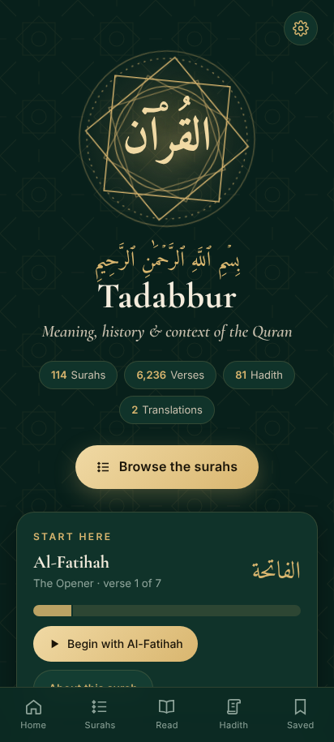
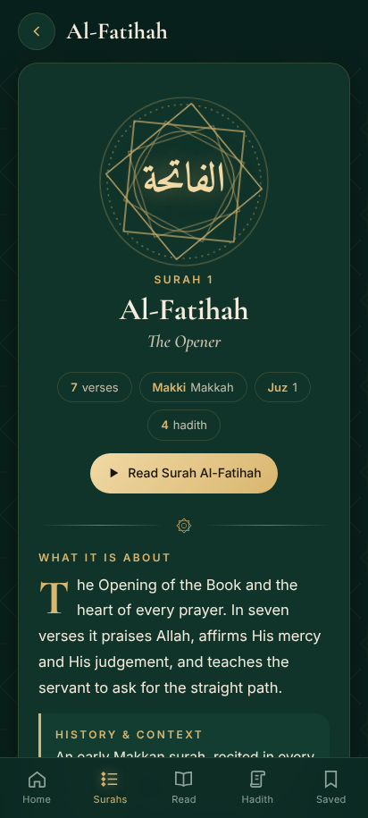
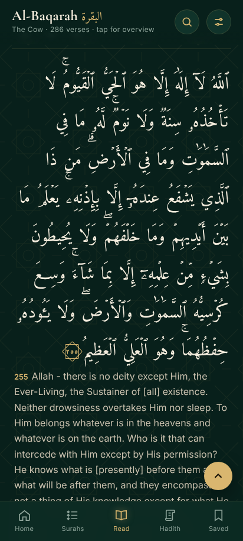
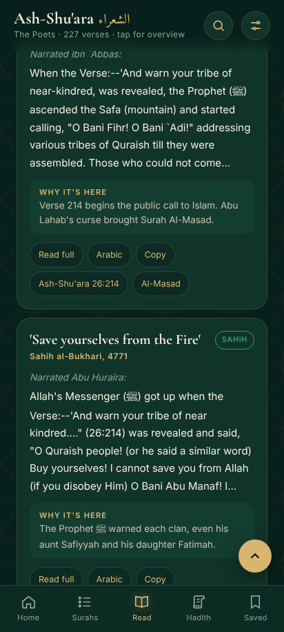
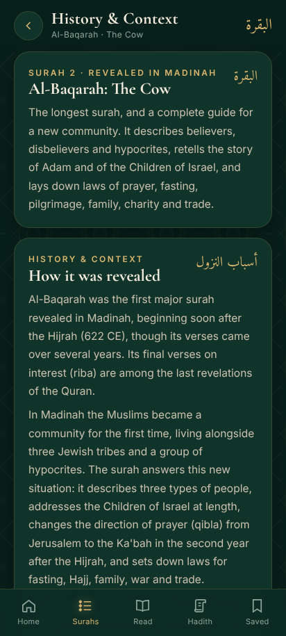
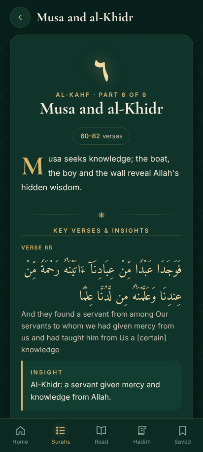
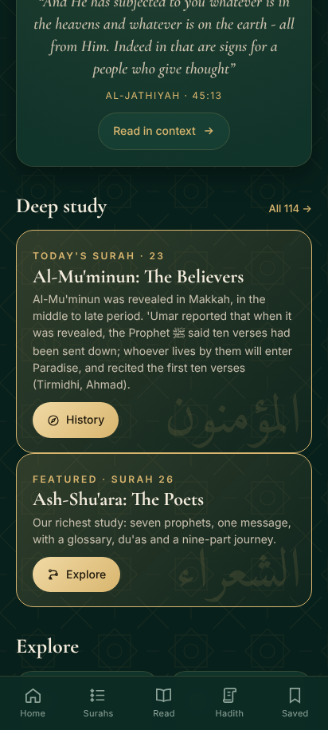
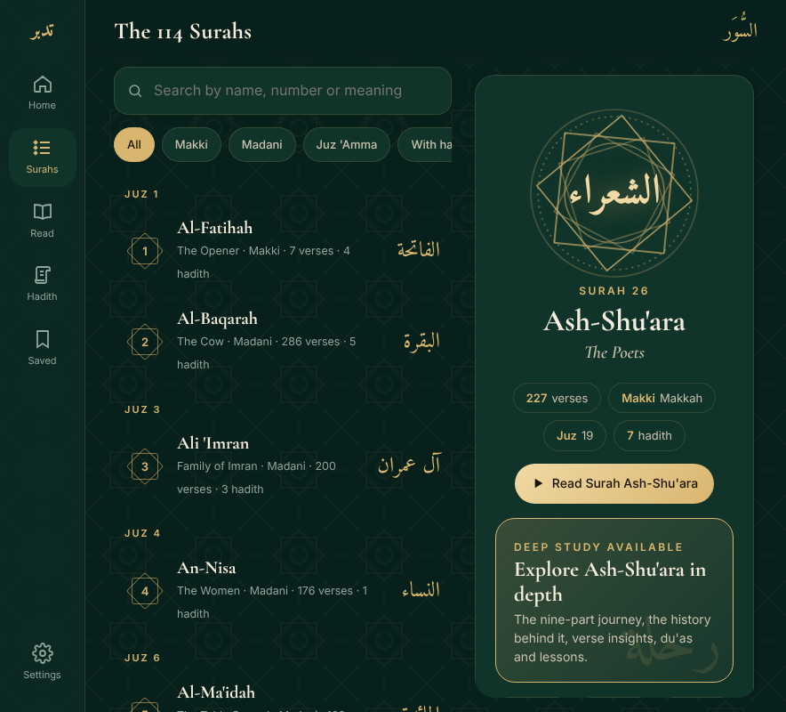
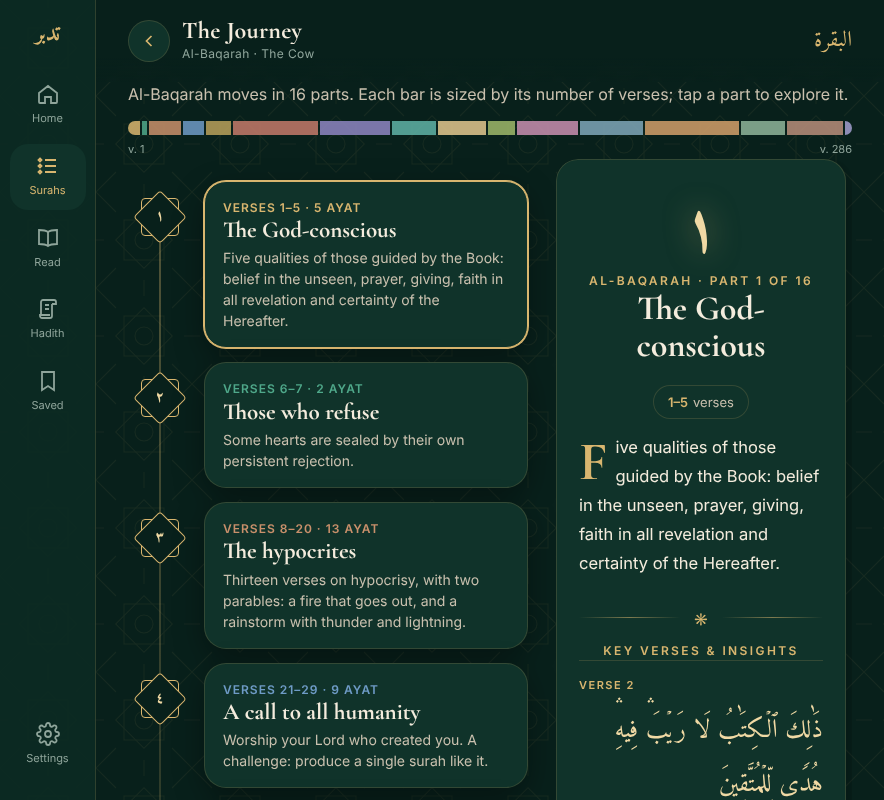

<p align="center"></p>

<h1 align="center">Tadabbur · تَدَبُّر</h1>
<p align="center"><b>Understand the meaning, history and context of the Quran, with linked authentic hadith.</b><br>
An Android app designed for the Samsung Galaxy Z Fold, adapting between the cover screen and the unfolded inner screen.</p>

<p align="center"><a href="https://github.com/BintChar247/tadabbur/raw/main/download/Tadabbur.apk"><b>⬇ Download Tadabbur.apk (v3.0, 2.2 MB)</b></a></p>

---

## Features

- **All 114 surahs.** Each has an overview covering what it is about, its history and context, its main themes and its key verses.
- **The full Quran text.** All 6,236 verses in Uthmani script, with English (Saheeh International) or Bahasa Indonesia (Kemenag) translation and optional transliteration.
- **81 authentic hadith linked to the verses they explain.** Each shows its collection, number and grading, and can be read in Arabic.
- **A deep study of every surah.** Each of the 114 surahs has:
  - its history and the circumstances of revelation (asbab al-nuzul);
  - a Journey through its sections, with verse ranges, key verses and related hadith;
  - verse-by-verse insights shown in the reader;
  - lessons and questions for reflection.

  In total there are 423 sections and over 1,200 verse notes. Surah 26, Ash-Shu'ara, has the richest study, with a glossary and du'as.
- **Reading tools.** Bookmarks, continue where you left off, search within a surah, copy and share a verse, Night and Day themes, and adjustable Arabic and translation size.
- **Built for foldables.** The cover screen uses bottom navigation. The unfolded screen uses a side rail, list-and-detail layouts, and Arabic beside its translation. Folding or unfolding keeps your place.

## Screenshots

| Home | Surah overview | Reader | Verse hadith |
|---|---|---|---|
|  |  |  |  |

| History & context | Journey section | Deep study on home |
|---|---|---|
|  |  |  |

| Unfolded: surah index | Unfolded: Journey |
|---|---|
|  |  |

## Install

1. On your phone, download [`Tadabbur.apk`](https://github.com/BintChar247/tadabbur/raw/main/download/Tadabbur.apk). It is also on the [Releases](https://github.com/BintChar247/tadabbur/releases) page.
2. Open it and allow "Install unknown apps" for your browser or Files app when asked.
3. Play Protect may warn that it doesn't recognise the app, because it isn't from the Play Store. Tap **Install anyway**.

It needs Android 7.0 or newer and works fully offline.

## Sources

- **Arabic text:** Uthmani script of the King Fahd Glorious Quran Printing Complex, via QuranEnc (packaged by [`quran-json`](https://github.com/risan/quran-json)).
- **Translations:** Saheeh International (English), Kementerian Agama RI (Bahasa Indonesia).
- **Hadith:** texts, references and gradings as published by Sunnah.com (packaged by the [`hadith`](https://www.npmjs.com/package/hadith) npm database). They were selected to favour Sahih al-Bukhari and Sahih Muslim, and others are included only where graded Sahih or Hasan.
- **Commentary:** the surah overviews and deep studies are summaries written for beginners from mainstream classical tafsir (Ibn Kathir, al-Tabari, al-Qurtubi) and the sirah. Where a report about the circumstances of revelation is weak or disputed, the text says so ("reports say", "some scholars"). They are not a substitute for a qualified teacher. *Wallahu a'lam*: and Allah knows best.
- **Fonts:** Amiri and Amiri Quran, Cormorant Garamond and Inter (SIL Open Font License).

## Project layout

```
android/            Android app (WebView shell + offline web UI)
  assets/           The app UI: index.html, app.js, style.css, content.js
    data/s1..s114.js  Quran text per surah (Arabic, transliteration, EN, ID)
    index.js          Surah metadata, overviews and curated hadith
    deep.js           Deep studies: history, sections, insights, lessons
  src/              MainActivity (WebView, share/copy bridge, system bars)
  build.sh          Build script (aapt, javac, dx, zipalign, apksigner)
tools/              Scripts and sources used to generate the data (tools/deep: deep-study sources)
docs/screenshots/   Screenshots
download/           Tadabbur.apk, the latest signed build
```

## Building

The app builds without Gradle, using the Debian/Ubuntu Android tools:

```bash
sudo apt-get install android-sdk-platform-23 aapt apksigner dalvik-exchange zipalign openjdk-17-jdk-headless
cd android
keytool -genkeypair -keystore release.jks -alias shuara -keyalg RSA -keysize 2048 -validity 10000
KS_PASS=yourpassword bash build.sh
```

The web UI in `android/assets` can also be opened directly in a browser for preview.
